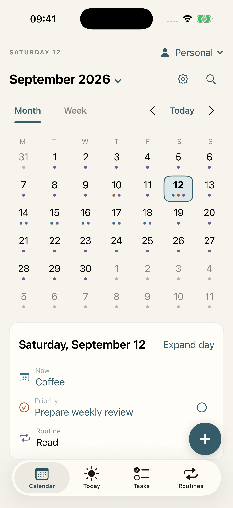
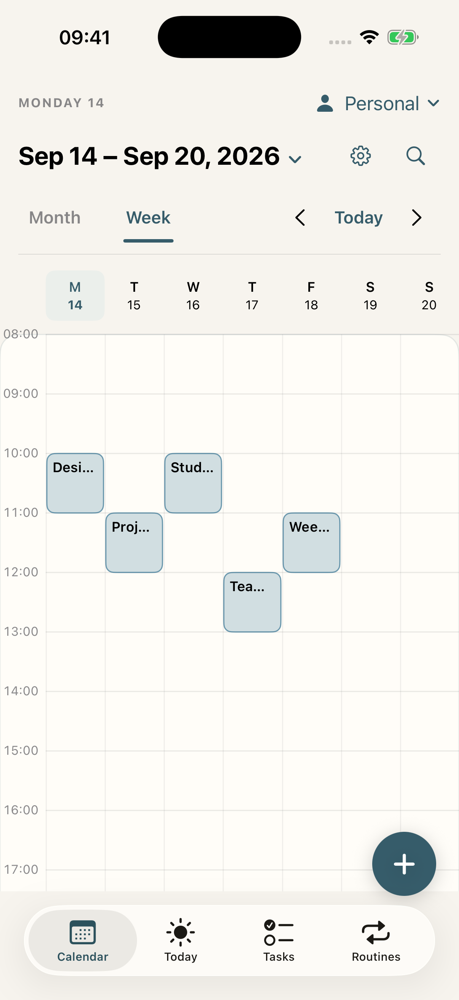
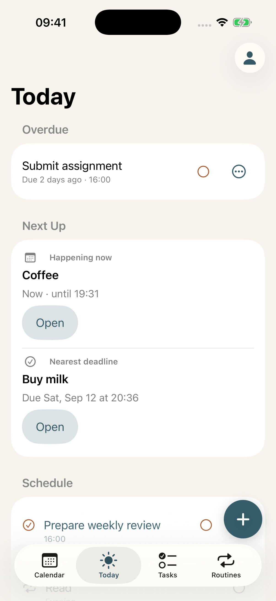
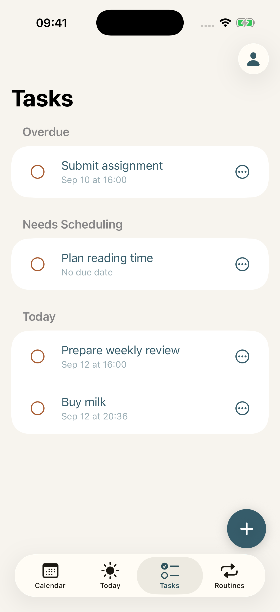
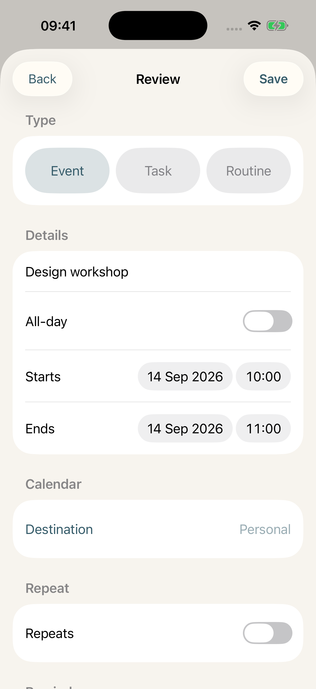
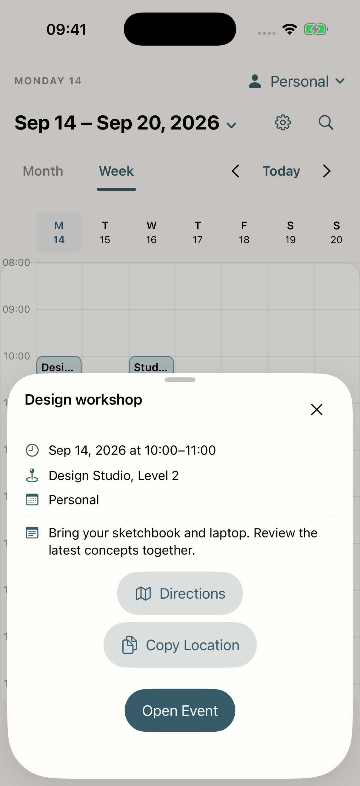

# Personal Calendar

Personal Calendar is a local-first iPhone planner that brings Apple Calendar events, Apple Reminders tasks, and local routines into profile-specific views. It requires iOS 17 or later.

## Screenshots

Current development preview from [build `186619b`](https://github.com/Jia7k/personal-calendar-ios/tree/186619b02bba772275d74d5e0a27728deb306634), captured on an iPhone 17 Pro simulator. All events, tasks, and locations shown are synthetic demo data. Tap a screenshot to view it at full resolution.

<table>
  <tr>
    <th>Month at a glance</th>
    <th>Your week, laid out</th>
  </tr>
  <tr>
    <td align="center"><a href="docs/screenshots/calendar-month.png"></a></td>
    <td align="center"><a href="docs/screenshots/calendar-week.png"></a></td>
  </tr>
  <tr>
    <th>What needs attention today</th>
    <th>Tasks, clearly grouped</th>
  </tr>
  <tr>
    <td align="center"><a href="docs/screenshots/today.png"></a></td>
    <td align="center"><a href="docs/screenshots/tasks.png"></a></td>
  </tr>
  <tr>
    <th>Review before saving</th>
    <th>Event details in reach</th>
  </tr>
  <tr>
    <td align="center"><a href="docs/screenshots/quick-entry.png"></a></td>
    <td align="center"><a href="docs/screenshots/event-details.png"></a></td>
  </tr>
</table>

## Build and test

Generate the Xcode project with:

```bash
xcodegen generate
```

Build with:

```bash
xcodebuild build -project PersonalCalendar.xcodeproj -scheme PersonalCalendar -destination 'generic/platform=iOS Simulator'
```

Run tests with:

```bash
xcodebuild test -project PersonalCalendar.xcodeproj -scheme PersonalCalendar -destination 'platform=iOS Simulator,name=iPhone 17 Pro'
```

Use the [foundation accessibility manual-QA checklist](docs/manual-qa/foundation-accessibility.md) for notification, Shortcuts, widget, Maps, VoiceOver, Accessibility XXXL, Reduce Motion, and fixed-light-appearance checks that automation cannot prove on a real system surface.

## Data ownership and backups

- Events remain in Apple Calendar.
- Tasks remain in Apple Reminders.
- Routines, completion history, categories, profiles, and preferences stay on this iPhone.
- Profiles store references to selected Apple or Google calendars and reminder lists. They never copy, move, or delete provider content.
- A manual backup contains app-owned profiles, routines, completions, categories, source/default selections, notification preferences, per-profile class-alert preferences, the foreground Live Activity preference, and bounded Quick Entry history and choices.
- Backups never contain Calendar event or Reminder task payloads. Per-widget configuration and a running Live Activity are system/runtime state and are not included.

The app has no backend, account, analytics, or CloudKit entitlement.

## Calendar profiles

Profiles group related calendars, reminder lists, and routines without changing their original source. Create or edit them in **Settings → Profiles**, then use the Profile menu in Calendar, Today, Tasks, or Routines.

For a school timetable synced from Google Calendar:

1. Keep the timetable in its own Google calendar and ensure it appears in Apple Calendar.
2. Open **Settings → Profiles → School**.
3. Select that dedicated calendar, the relevant assignment list, and any study routines. Choose writable defaults if new school items should be saved there.

**Everything** is the deduplicated union of content assigned to saved profiles. A provider calendar that is not assigned anywhere—such as Birthdays—does not appear in Everything. This keeps unrelated calendars out without disabling or deleting them.

## Everyday workflows

### Triage overdue tasks

The Tasks screen keeps Overdue separate from Today. Swipe an editable, nonrecurring overdue task for **Tomorrow** or **Next Week**, or use its actions menu for **Later Today**, **Tomorrow**, **Next Week**, or **Pick Date**. A successful change exposes one **Undo reschedule** action that restores the exact previous schedule. Recurring and read-only tasks stay on the full editor path.

Completing a task from Today also offers a one-item Undo. Tasks shown in Calendar's Week view can be completed without leaving the planner.

### Schedule focused time

Open a task's actions and choose **Schedule Time**. Pick a 30-, 60-, or 90-minute suggestion, adjust the interval if needed, and choose a writable calendar in the active saved profile. Suggestions account for existing timed events and the task's due date. If the chosen interval overlaps another event, the app names the conflict and requires **Save Anyway**.

Saving creates a separate Calendar event; the original Reminder remains unchanged.

### Capture with Quick Entry and Shortcuts

Quick Entry parses a short phrase into an event, task, or routine and always shows an in-app confirmation before writing. Successful entries are kept in a bounded recent list, and safe choices such as duration, category, and destination are remembered separately for each saved profile and item kind.

The **Quick Add** action is available in Shortcuts, Siri, Spotlight, and the Action Button where supported. Its suggested Siri phrases are “Add to My Calendar” and “Plan with My Calendar.” The shortcut can target a saved profile, writes only a one-time handoff, opens the app, and never silently saves provider data.

### See what is next

Today shows a **Next Up** card for the current or next timed event and the nearest incomplete deadline. Use **Open** to edit the underlying item. When an event has a location, **Maps** searches that location in Apple Maps.

Calendar includes profile-scoped search, Month and Week views, and **Jump to Date**. Week shows events as timed blocks, tasks as due markers, and routines for the selected day.

### Use actionable alerts

In **Settings → Notifications**, configure the morning summary and per-saved-profile class alerts. Class alerts are opt-in and can fire 5, 10, 15, 20, or 30 minutes before a timed event; tapping one opens the exact profile and class when it is still available.

Routine reminder notifications support **Complete** and **Snooze 15 min**. Notification actions revalidate the current routine and day before changing anything. Tapping a morning summary opens Today.

## Timetable widgets and Live Activity

The timetable uses timed Monday–Friday events from the profile selected for each widget. Long-press a widget, choose **Edit Widget**, and select Personal, School, Work, or Everything. Each widget instance keeps its own selection. Widgets created by an older static build must be configured once after updating.

- **Next Class:** customize the Lock Screen, choose **Add Widgets**, select **My Calendar**, and add the rectangular **Next Class** widget.
- **Weekly Timetable:** edit the Home Screen, choose **Add Widget**, select **My Calendar**, and add the medium weekly widget.
- **Full timetable Live Activity:** open **Settings → Timetable**, select a profile, and tap **Start Live Activity**. Optionally enable **Start when Personal Calendar opens** to start or reconcile that exact profile after a successful foreground refresh. Switching profiles ends the old activity before starting the selected one. Use **Stop for now** to remove it until the next enabled foreground start.

Tapping a ready **Next Class** widget opens its exact current or upcoming class on that occurrence's local day in the widget's configured profile. After the last class, it opens that exact profile and the widget's represented local day without selecting an arbitrary event. Tapping **Weekly Timetable** opens its represented local day in that exact configured profile without selecting an event. Tapping a Live Activity on the Lock Screen or Dynamic Island opens its exact current or upcoming class when the activity has an occurrence identity; an older activity without that identity, or a current activity with no current/upcoming class, opens the exact activity profile and current local day instead.

If a previously rendered link refers to an occurrence or saved profile that was later deleted, the authoritative app route shows the neutral **Can’t Open This Item** unavailable message and never falls back to Everything; occurrence lookup refreshes only within the requested profile. Current choose-profile, deleted-profile, permission-required, empty-profile, no-classes, and invalid-time-zone states have no link and remain inert. A malformed nonblank occurrence route ID makes an occurrence-selecting Next Class or Live Activity link fail closed and remain inert; a ready Weekly Timetable still opens its exact profile/day because it never uses an occurrence ID. The versioned `personalcalendar://v1/calendar` surface URLs are deliberately narrow: they carry only the Gregorian day, profile storage key, and, when available, an opaque occurrence ID formed by `entry-` plus 16 lowercase hexadecimal digits. They never contain titles, locations, notes, alarms, EventKit display or mutation IDs, or raw provider payloads. Ready Next Class and Weekly Timetable links expose the VoiceOver hints **Opens this timetable in My Calendar** and **Opens this week in My Calendar**, respectively.

Widgets read a weekly snapshot produced by the app. Open Personal Calendar after changing provider events, permissions, time zone, or profile membership so it can rebuild that snapshot. Timetable data is treated as stale after six hours; the Live Activity asks you to open the app when its data is stale. WidgetKit still controls the exact reload time.

These links do not change the timetable's local/foreground refresh limits. The app has no push server. A Live Activity updates only while iOS gives the app runtime, and iOS limits an activity to eight active hours. The optional saved automatic-start preference runs only when Personal Calendar opens or returns to the foreground after refreshing its catalog. Guaranteed background start, transition, refresh, or termination is outside this MVP.

## Appearance and device installation

The app intentionally uses the light-only Harbor & Linen appearance, even when the iPhone is set to Dark Mode.

Open `PersonalCalendar.xcodeproj`, choose your Development Team under Signing & Capabilities, connect an iPhone running iOS 17 or later, and press Run. A free Personal Team installation may need to be renewed periodically.

The app and `PersonalCalendarWidgets` extension both use the App Group `group.local.personalcalendar.shared`. Provision that App Group for both bundle identifiers before installing on a physical device.
